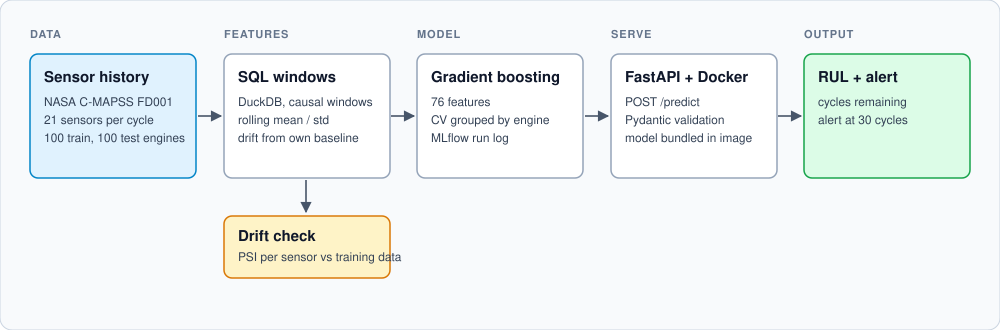
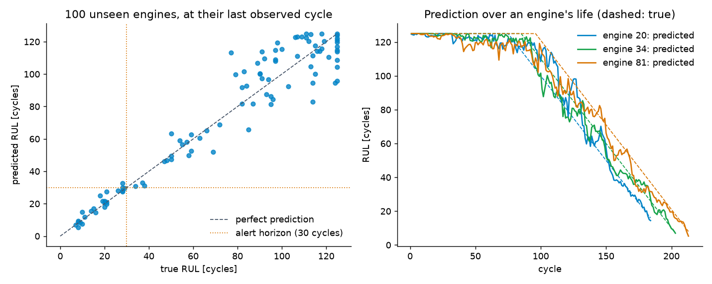

# turbofan-rul

**Predictive maintenance on the NASA C-MAPSS turbofan data:** predict how many cycles an engine has left (remaining useful life, RUL), raise a maintenance alert, watch the inputs for drift, and serve it over HTTP.

[](https://github.com/DanielYamanoglu/turbofan-rul/actions/workflows/ci.yml)

-0284c7)




> **Real benchmark data, official test split.** The model is scored on 100 engines it never saw, against NASA's ground-truth RUL. The data is downloaded by `turbofan-rul download` and is not stored in this repository.

## Results

FD001 subset: 100 engines run to failure for training (20,631 cycles), 100 unseen engines for testing. Scored at each test engine's last observed cycle against NASA's ground truth.

| Model | CV RMSE (by engine) | Test RMSE | NASA score |
|---|---|---|---|
| Ridge on raw sensors (baseline) | 21.7 | 20.6 | 1225 |
| Gradient boosting on 76 engineered features | **8.9** | **11.2** | **190** |

- **Maintenance alert** (predicted RUL ≤ 30 cycles): 25 test engines were actually within 30 cycles of failure; the model flagged 24 of them with no false alarms (precision 1.00, recall 0.96).
- RUL labels are capped at 125 cycles, the usual convention for this dataset. Against uncapped test labels the same predictions give RMSE 12.4.
- Removing engine age (`cycle`) from the features raises test RMSE to 14.9, so a good part of the gain comes from knowing how old the engine is.



Left: every test engine at its last observed cycle. Predictions are tight where it matters, near failure, and looser for healthy engines far from it. Right: the prediction tracks the true RUL through the whole degradation phase of three test engines.

Reproduce with `turbofan-rul train`; the numbers land in [`models/metrics.json`](models/metrics.json) and in the MLflow run. `scripts/plot_results.py` renders the figure.

## Example

```text
$ curl -s localhost:8000/predict -H 'content-type: application/json' -d @engine_34_history.json
{"rul_cycles": 7.0, "maintenance_alert": true, "cycles_seen": 203}
```

The request body is the engine's history so far, one reading per cycle (3 operating settings and 21 sensors). For this test engine NASA's ground truth is 7 cycles.

## How it works

- **Features in SQL.** Rolling mean (10 and 30 cycles), rolling standard deviation and drift from each engine's own first 20 cycles, written as window functions and executed by DuckDB (`features.py`). Every window ends at the current row; a test checks that appending future cycles does not change past features.
- **Validation without leakage.** Cross-validation folds are split by engine, so cycles of one engine never appear on both sides.
- **Asymmetric scoring.** Besides RMSE, the PHM08 score penalises late predictions harder than early ones, which is what matters for maintenance.
- **Drift monitoring.** Population stability index per sensor against the training engines (`turbofan-rul drift`):

  | Compared with training engines 1–50 | Sensors over PSI 0.2 | Max PSI |
  |---|---|---|
  | Training engines 51–100 (control) | 0 / 15 | 0.05 |
  | Test engines (stopped before failure) | 12 / 15 | 0.33 |
  | FD003 (a second fault mode) | 10 / 15 | 0.82 |

- **Serving.** `POST /predict` takes one engine's history and returns RUL and the alert flag; requests are validated with Pydantic.

## Run

```bash
uv sync
uv run turbofan-rul download
uv run pytest
uv run turbofan-rul train
uv run turbofan-rul drift
uv run uvicorn turbofan_rul.api:app
```

Or the API in a container (the trained model is in `models/`):

```bash
docker build -t turbofan-rul . && docker run -p 8000:8000 turbofan-rul
```

## Project structure

```
src/turbofan_rul/data.py      download and load C-MAPSS, RUL labels with the 125-cycle cap
src/turbofan_rul/features.py  SQL window features, generated per sensor and run in DuckDB
src/turbofan_rul/train.py     grouped cross-validation, test scoring, model bundle, MLflow logging
src/turbofan_rul/metrics.py   RMSE, PHM08 score, alert precision/recall, PSI
src/turbofan_rul/monitor.py   per-sensor drift report
src/turbofan_rul/api.py       FastAPI service
scripts/plot_results.py       README figure
models/                       trained model and metrics.json
tests/                        9 tests: causal features, label capping, scoring functions, PSI, API contract
Dockerfile                    API image with the model bundled
```

## Limitations

- Trained and tested on FD001 only (one operating condition, one fault mode). The drift table shows FD003 inputs differ; the model is not expected to transfer without retraining.
- C-MAPSS is simulated data. Real telemetry has missing values, sensor faults and irregular sampling that this pipeline does not handle.
- Hyperparameters were set by hand, not searched.
- The drift check covers input distributions only; it does not track prediction quality over time.

## What I'd do next

- Train across all four C-MAPSS subsets, with operating-condition normalisation for FD002 and FD004.
- Quantile regression for prediction intervals, so an alert carries its uncertainty.
- Hyperparameter search inside the grouped cross-validation.
- Track prediction quality over time, not only input drift, and trigger retraining from it.

## License

MIT. See [LICENSE](LICENSE). Data: NASA Prognostics Center of Excellence, Turbofan Engine Degradation Simulation Data Set (Saxena et al., 2008).
